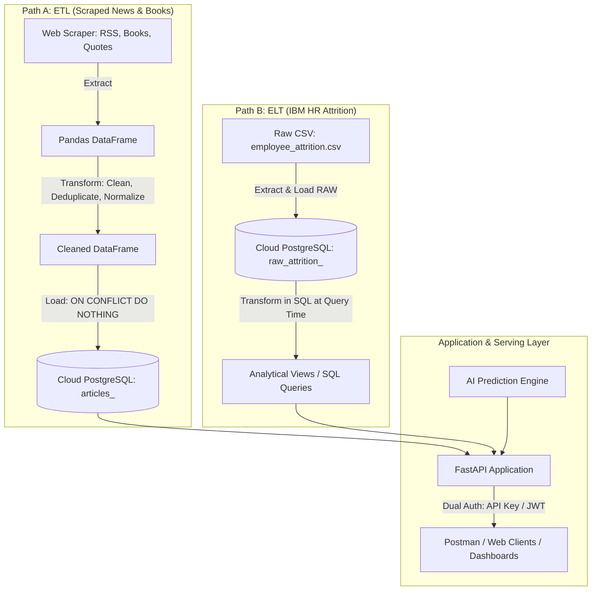

# 🚀 End-to-End Data Pipeline & AI-Powered REST API
### Mini Project 2 — DigitalSkola Data Engineering & AI

Proyek ini mengimplementasikan arsitektur data pipeline modern end-to-end yang menggabungkan dua paradigma utama: **ETL (Extract, Transform, Load)** dan **ELT (Extract, Load, Transform)**, serta menyajikan data dan model machine learning melalui **RESTful API performa tinggi berbasis FastAPI** dengan dual-authentication (API Key & JWT Bearer Token).

---

## 📌 Daftar Isi
- [Arsitektur Sistem](#-arsitektur-sistem)
- [Fitur Utama](#-fitur-utama)
- [Struktur Direktori](#-struktur-direktori)
- [Instalasi & Persiapan](#-instalasi--persiapan)
- [Menjalankan Data Pipeline](#-menjalankan-data-pipeline)
- [Menjalankan REST API Server](#-menjalankan-rest-api-server)
- [Dokumentasi Endpoint API](#-dokumentasi-endpoint-api)
- [Autentikasi & Keamanan](#-autentikasi--keamanan)
- [Pengujian dengan Postman](#-pengujian-dengan-postman)
- [Proteksi Data & Kredensial](#-proteksi-data--kredensial)

---

## 🏗 Arsitektur Sistem



### 1. Path A — ETL (Extract, Transform, Load)
* **Extract:** Mengambil data artikel berita dari feed RSS (BBC, NYTimes, CNN) dan web scraping HTML dari Books to Scrape serta Quotes to Scrape menggunakan `BeautifulSoup` & `requests`.
* **Transform:** Pembersihan data dilakukan **sebelum** dimuat ke database menggunakan `pandas` (menghapus duplikat URL, membuang null values, normalisasi teks lowercase & whitespace trimming, standardisasi format waktu UTC).
* **Load:** Menyimpan data bersih ke tabel PostgreSQL dengan klausa `ON CONFLICT (url) DO NOTHING` untuk memastikan idempotency.

### 2. Path B — ELT (Extract, Load, Transform)
* **Extract & Load:** Membaca data mentah `employee_attrition.csv` dan memuatnya secara langsung ke database tanpa modifikasi struktur (*zero-transformation ingestion*).
* **Transform:** Transformasi data dan agregasi analitik dilakukan **di dalam database** saat query dieksekusi (*Query-Time Transformation*) menggunakan SQL agregasi, filter bersyarat, case bucketing, dan window functions.

### 3. Path C — AI Prediction & Serving Layer
* Layanan inferensi prediksi sentimen berbasis input teks dan threshold probabilitas.
* Penyajian katalog data referensi produk (`/data`).
* Pencarian artikel multi-filter dengan pagination dinamis (`/articles/search`).

---

## ✨ Fitur Utama

- **Dual-Pipeline Pattern:** Mendemonstrasikan perbedaan nyata kapan harus menggunakan ETL vs ELT.
- **RESTful API Berstandar OpenAPI:** Dibangun menggunakan FastAPI dengan dokumentasi interaktif otomatis (Swagger UI & Redoc).
- **Dual Authentication Mechanism:** Mendukung autentikasi melalui header `X-API-Key` dan OAuth2 JWT Bearer Token (`/token`).
- **Analitik SQL Mutakhir:** Menggunakan agregasi `FILTER (WHERE ...)`, `CASE WHEN` bucketing, serta Window Function `RANK() OVER (PARTITION BY Department ORDER BY MonthlyIncome DESC)`.
- **Keamanan Berlapis (Defense in Depth):** Dilengkapi proteksi `.gitignore`, `.aiexclude` (Google Cloud / Gemini AI), `.cursorignore`, `.copilotignore`, dan `.dockerignore` untuk mencegah kebocoran data dan kredensial.

---

## 📂 Struktur Direktori

```text
├── .aiexclude               # Proteksi AI Gemini / Google Cloud (mencegah scraping kredensial & data)
├── .copilotignore           # Proteksi GitHub Copilot
├── .cursorignore            # Proteksi Cursor AI indexing & chat
├── .dockerignore            # Mencegah secrets & dataset masuk ke Docker image build
├── .env.example             # Template variabel lingkungan publik (aman di-commit)
├── .gitignore               # Konfigurasi pengabaian Git (secrets, raw datasets, cache)
├── cleaner.py               # Modul transformasi & data cleaning artikel (Pandas)
├── db.py                    # Koneksi database SQLAlchemy & fungsi query/agregasi analitik
├── employee_attrition.csv   # Dataset mentah IBM HR Employee Attrition
├── main.py                  # Server FastAPI, middleware autentikasi, dan endpoint API
├── miniproject2_API.postman_collection.json # Koleksi pengujian Postman siap pakai
├── pipeline.py              # CLI orchestrator eksekusi ETL & ELT pipeline
├── requirements.txt         # Daftar dependency Python
├── scraper.py               # Scraper multi-sumber (BeautifulSoup & RSS parser)
├── transform_attrition.sql  # Kumpulan query transformasi analitik PostgreSQL
└── README.md                # Dokumentasi proyek
```

---

## ⚙️ Instalasi & Persiapan

### 1. Clone Repository
```bash
git clone git@github.com:bayuspatial/miniproject2.git
cd miniproject2
```

### 2. Buat & Aktifkan Virtual Environment
```bash
# macOS / Linux
python3 -m venv .venv
source .venv/bin/activate

# Windows (PowerShell)
python -m venv .venv
.venv\Scripts\Activate.ps1
```

### 3. Install Dependencies
```bash
pip install --upgrade pip
pip install -r requirements.txt
```

### 4. Konfigurasi Environment Variables
Salin file template `.env.example` menjadi `.env`, lalu lengkapi nilai konfigurasi Anda sesuai instruksi di dalamnya:
```bash
cp .env.example .env
# Edit file .env dan sesuaikan dengan kredensial database dan API Anda
```

Variabel yang perlu dikonfigurasi pada `.env` (lihat rincian di `.env.example`):
- `DATABASE_URL`: URI koneksi PostgreSQL database
- `STUDENT_NAME`: Identifier / nama siswa
- `INTERNAL_API_KEY`: API key untuk mengamankan akses internal
- `JWT_SECRET`: Secret key untuk penandatanganan token JWT
- `JWT_EXPIRY_MINUTES`: Masa berlaku token JWT (default: 30 menit)
- `CLIENT_ID` & `CLIENT_SECRET`: Kredensial untuk autentikasi endpoint `/token`

---

## 🔄 Menjalankan Data Pipeline

Script `pipeline.py` berfungsi sebagai orkestrator CLI untuk mengeksekusi pipeline ETL dan ELT.

### Menjalankan Seluruh Pipeline (ETL & ELT)
```bash
python pipeline.py --attrition-csv employee_attrition.csv --book-pages 5 --quote-pages 5
```

### Menjalankan Hanya Path A (ETL Scraping)
```bash
python pipeline.py --book-pages 10 --quote-pages 10
```

### Menjalankan Hanya Path B (ELT Raw Ingestion & SQL Transform)
```bash
python pipeline.py --skip-scraping --attrition-csv employee_attrition.csv
```

---

## 🌐 Menjalankan REST API Server

Jalankan server pengembangan FastAPI dengan hot-reload:
```bash
uvicorn main:app --reload --host 0.0.0.0 --port 8000
```

Setelah server aktif, dokumentasi interaktif dapat diakses di browser:
* **Interactive Swagger UI:** [http://localhost:8000/docs](http://localhost:8000/docs)
* **ReDoc Documentation:** [http://localhost:8000/redoc](http://localhost:8000/redoc)

---

## 📖 Dokumentasi Endpoint API

### 1. Public & System
| Method | Endpoint | Deskripsi | Autentikasi |
| :--- | :--- | :--- | :--- |
| `GET` | `/` | Informasi root API, nama student, dan daftar path | Tidak |
| `GET` | `/health` | Status kesehatan layanan dan timestamp UTC | Tidak |
| `GET` | `/data` | Sampel dataset referensi produk (filter `category` & `limit`) | Tidak |
| `POST` | `/predict` | Prediksi sentimen teks berbasis AI dengan threshold | Tidak |

#### Contoh Request `/predict`:
```bash
curl -X POST "http://localhost:8000/predict" \
     -H "Content-Type: application/json" \
     -d '{
       "text": "Pelayanan aplikasi ini sangat cepat, responsif, dan mudah digunakan.",
       "threshold": 0.7
     }'
```
Response:
```json
{
  "label": "positive",
  "confidence": 0.88,
  "input_text": "Pelayanan aplikasi ini sangat cepat, responsif, dan mudah digunakan."
}
```

---

### 2. Autentikasi (`/token`)
| Method | Endpoint | Deskripsi | Request Body |
| :--- | :--- | :--- | :--- |
| `POST` | `/token` | Exchange `client_id` & `client_secret` untuk JWT token | `{"client_id": "...", "client_secret": "..."}` |

Response:
```json
{
  "access_token": "eyJhbGciOiJIUzI1NiIsIn...",
  "token_type": "bearer",
  "expires_in": 1800
}
```

---

### 3. Articles (ETL Path A)
*Semua endpoint di bawah memerlukan autentikasi (`X-API-Key` atau `Bearer Token`).*

| Method | Endpoint | Parameter Query | Deskripsi |
| :--- | :--- | :--- | :--- |
| `GET` | `/articles/stats` | - | Agregasi total artikel & perincian per sumber |
| `GET` | `/articles` | `source`, `title`, `limit` | Mengambil daftar artikel dengan filter opsional |
| `GET` | `/articles/search` | `source`, `title`, `date_from`, `date_to`, `page`, `per_page` | Pencarian artikel multi-kriteria dengan paginasi |
| `GET` | `/articles/{id}` | Path param `id` | Detail artikel spesifik berdasarkan ID database |

#### Contoh Request Pencarian dengan Paginasi:
```bash
curl -X GET "http://localhost:8000/articles/search?source=books.toscrape&page=1&per_page=5" \
     -H "X-API-Key: <YOUR_API_KEY>"
```

---

### 4. HR Attrition Analytics (ELT Path B)
Endpoint analitik data HR Attrition yang ditransformasikan secara langsung melalui query SQL database:

| Method | Endpoint | Parameter | Deskripsi & Logika SQL Utama |
| :--- | :--- | :--- | :--- |
| `GET` | `/attrition/department/{dept_name}` | Path: `dept_name` | Agregasi statistik departemen (total, rasio keluar, rata-rata & rentang gaji) serta Top 3 Earners via `RANK() OVER (ORDER BY MonthlyIncome DESC)` |
| `GET` | `/attrition/risk-profile` | Query: `limit` (1–100, default 20) | Daftar karyawan dengan indikator risiko tinggi: `OverTime = 'Yes'`, `YearsAtCompany < 3`, dan `MonthlyIncome < avg_income` |

---

## 🔐 Autentikasi & Keamanan

API mendukung **Dual Authentication** pada endpoint yang terproteksi:

### 1. Metode API Key
Kirimkan API Key melalui request header `X-API-Key`:
```http
GET /articles/stats HTTP/1.1
Host: localhost:8000
X-API-Key: <YOUR_API_KEY>
```

### 2. Metode JWT Bearer Token
1. Lakukan request ke `POST /token` dengan `client_id` dan `client_secret`.
2. Gunakan token yang didapat pada header `Authorization`:
```http
GET /attrition/summary HTTP/1.1
Host: localhost:8000
Authorization: Bearer <jwt_access_token>
```

---

## 🧪 Pengujian dengan Postman

Repositori ini menyertakan koleksi pengujian lengkap di `miniproject2_API.postman_collection.json`.

### Cara Menggunakan:
1. Buka aplikasi **Postman** dan klik **Import**.
2. Pilih file `miniproject2_API.postman_collection.json`.
3. Koleksi telah disusun langsung sesuai dengan 7 checklist pengujian tugas:
   - `1. GET /articles/search - tanpa filter (default pagination)`
   - `2. GET /articles/search - dengan filter source + date_from`
   - `3. GET /articles/search - page 2 (bukti pagination berjalan)`
   - `4. GET /articles/stats - total dan per-source breakdown`
   - `5. GET /attrition/department/Sales - detail satu department`
   - `6. GET /attrition/risk-profile - karyawan high-risk`
   - `7. POST /token atau GET dengan API Key - bukti auth berjalan` (mencakup POST token, GET API key, dan uji penolakan 401 tanpa auth).

---

## 🛡 Proteksi Data & Kredensial

Untuk mematuhi praktik tata kelola data terbaik (*Data Governance*) dan mencegah kebocoran kredensial atau penyerapan dataset privat oleh model AI:

| File Konfigurasi | Sasaran Proteksi | Peran Utama |
| :--- | :--- | :--- |
| **`.gitignore`** | Git Version Control | Mengabaikan `.env`, file dataset `*.csv`, `__pycache__`, dan log |
| **`.aiexclude`** | Gemini / Google Cloud AI | Mencegah AI membaca atau menggunakan dataset dan credentials |
| **`.cursorignore`** | Cursor AI IDE | Mencegah indexing codebase dan chat AI membaca file sensitif |
| **`.copilotignore`** | GitHub Copilot | Memblokir Copilot menyertakan kredensial ke context prompt |
| **`.dockerignore`** | Container Image | Mencegah file secrets dan data mentah terbungkus ke Docker build |
| **`.env.example`** | Tim / Kontributor | Menyediakan template konfigurasi publik yang aman tanpa data sensitif |

---

## 👨‍💻 Kontributor
**Bayu Kurniawan R**  
*Mini Project 2 — End to End Data Pipeline & AI Service*  
DigitalSkola Data Engineering & AI Program
